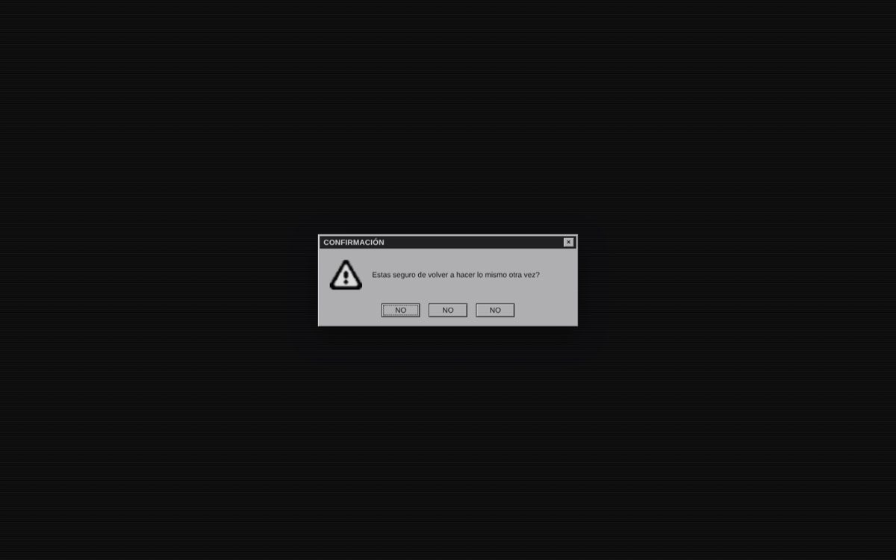
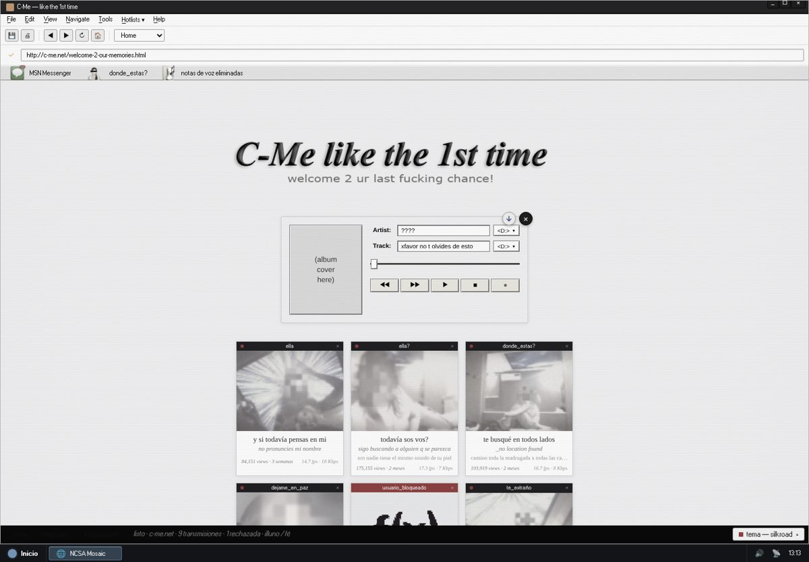
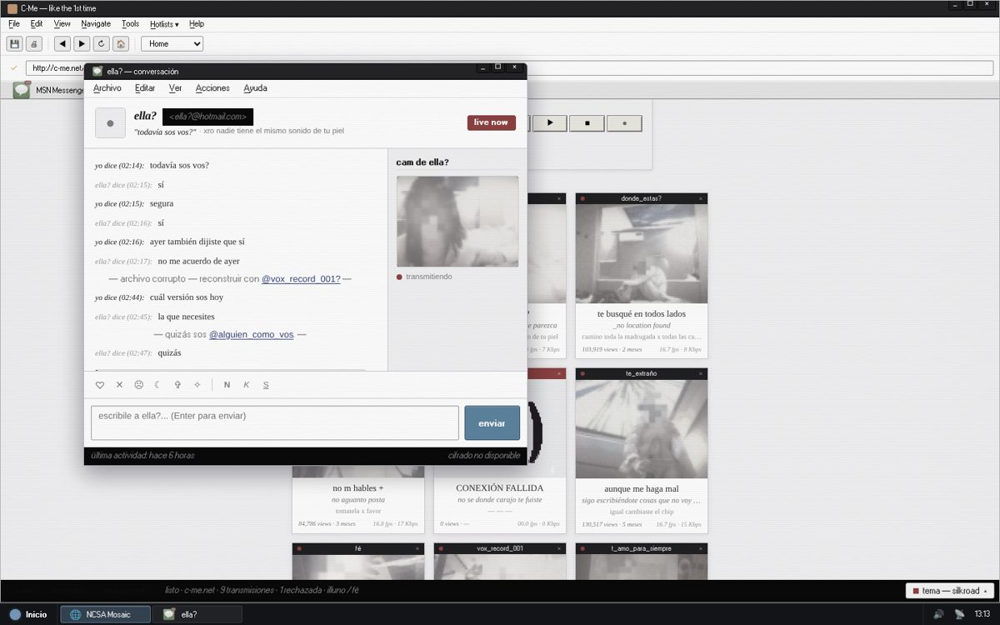

<div align="center">

# C-Me — like the 1st time

*An interactive launch site for Illuno's debut album · Un sitio interactivo de lanzamiento del disco debut de Illuno*

**[🇬🇧 English](#-english) · [🇦🇷 Español](#-español) · [▶ Live / En vivo](https://2001faithisthelaw.github.io/c-melikethe1stime/)**



</div>

---

## 🇬🇧 English

### About

**C-Me — like the 1st time** is a website built as an experience instead of a promo page. It simulates an early-2000s desktop in which every window orbits the same absence. The main app, **C-Me**, is a fictional webcam service with nine feeds, each one a phase of the same obsession. From there you open chats, a file-search window, a voice-note player with the album's tracks and a classifieds page.

I handled the whole chain: concept, writing, UX/UI design, front-end development and deployment, with Claude Code as a development tool and every output reviewed by hand. Reference: the 2001 *Donnie Darko* website.

<p align="center"> </p>

### How to explore it

Nothing is locked. You move through the site by following the links between characters and files:

1. **Entry dialog.** The site opens with a confirmation box and three buttons that all say **NO**. Any of them takes you in.
2. **Feeds.** Click one of the nine transmissions to open a chat with that character. Each chat has its own conversation.
3. **Mentions.** `@names` inside the chats open the other characters' conversations.
4. **donde_estas?** A fake file-search window. Every file belongs to a character; double-click opens their chat.
5. **Address bar.** Type a word such as `msn`, `busca`, `mp3` or `anuncio` and press Enter to open the matching window.
6. **Menus.** *Tools → Ver código fuente* (`Ctrl+U`) and *Herramientas de desarrollador* (`F12`) show narrative debug text, and *View → Mostrar bloqueados* counts how many times you tried to write to the blocked user.
7. **The blocked user.** Their tile and their camera show *f(x)*, and their camera carries one hyperlink: *"we will eventually find each other"*. Their chat never lets you send a message.

### The look

- Videos are graded pale and washed out, pixelated, with the face covered by irregular blocks that follow it frame by frame. The script that does it is in [`Ferst-Intro/tools`](Ferst-Intro/tools).
- Soft serif typography, thin borders, flat colors, no gradients.
- Empty-signal boxes carry a single hyperlink over blurred photos that change block by block.

### Tech

React 18 and Vite. No runtime dependencies beyond React. Everything runs in the browser.

### Run it locally

```bash
cd Ferst-Intro
npm install
npm run dev          # http://localhost:5173
```

```bash
npm run build        # outputs Ferst-Intro/dist
npm run preview      # serves the build
```

### Publish it (GitHub Pages)

The workflow in [`.github/workflows/pages.yml`](.github/workflows/pages.yml) builds and publishes the site on every push to `main`.

1. Merge your branch into `main`.
2. Go to **Settings → Pages** and set **Source** to **GitHub Actions** (once).
3. Wait for the run in **Actions** to finish. The site lives at <https://2001faithisthelaw.github.io/c-melikethe1stime/>.

### Publish it (Vercel)

The repo includes a root [`vercel.json`](vercel.json), so it imports as is.

1. On [vercel.com](https://vercel.com) choose **Add New… → Project** and import this repository.
2. Leave everything as it is and press **Deploy**. Vercel gives you a public `*.vercel.app` link.

From the terminal, with the built site: `cd Ferst-Intro && npm run build && cd dist && npx vercel --prod`.

### Likes and messages

Visitors can leave a ♡ on each character and send messages in the chats. Nothing is loaded back into the page: messages are stored apart and only you can read them.

- **Likes:** one per browser per character. Counts show next to the chat header.
- **Messages:** saved with an approximate location (country / region / city) and an anonymous code for the connection, which lets you spot repeat senders without storing IPs. Storing the full IP is off by default (`STORE_RAW_IP=1` turns it on); if you enable it, tell visitors. The chat already shows a short notice.
- **Favorites:** every message gets a simple composition score (length, punctuation, repeated letters, ALL CAPS, links, insults). Those above 70 become favorites on their own, and you can star or unstar any message by hand. It is a heuristic, not an AI judge.
- **Private panel:** `/admin.html` lists the messages (newest first) with place, time, connection code and score. It asks for `ADMIN_TOKEN`.
- **Needs a server:** it runs as Vercel functions (`api/`) with Upstash Redis. On GitHub Pages the buttons simply do not appear, unless you point `VITE_API_BASE` at your Vercel address.

Setup on Vercel: **Storage → Marketplace → Upstash Redis → Connect to project**, then add `ADMIN_TOKEN` and `IP_SALT` under **Settings → Environment Variables** (see [`.env.example`](.env.example)) and redeploy.

Local test: `node --test tests/api.test.cjs tests/upstash.test.cjs`. To try it in the browser, run `node Ferst-Intro/tools/dev-api.mjs` next to `npm run dev` (panel token: `dev`).

### Regenerate the videos

The videos in `Ferst-Intro/public/` are processed from the originals in `Ferst-Intro/media-src/`, which the site does not serve.

```bash
pip install opencv-python-headless numpy     # ffmpeg must also be installed
python3 Ferst-Intro/tools/heavencore.py
```

Color, pixelation and face blocks are tuned inside `tools/heavencore.py`.

### Credits

- **Illuno** ([@1l_uno](https://www.instagram.com/1l_uno/)) — Music
- **Federica Geriboni** ([@faithisthelawfaithunderwill](https://www.instagram.com/faithisthelawfaithunderwill/)) — Creative Direction & Development

---

## 🇦🇷 Español

### Sobre el proyecto

**C-Me — like the 1st time** es un sitio pensado como una experiencia y no como una página promocional. Simula un escritorio de principios de los 2000 en el que cada ventana orbita la misma ausencia. La app principal, **C-Me**, es un servicio ficticio de webcams con nueve transmisiones, cada una una fase de la misma obsesión. Desde ahí se abren chats, una ventana de búsqueda de archivos, un reproductor de notas de voz con los temas del disco y una página de clasificados.

Me ocupé de toda la cadena: concepto, escritura, diseño UX/UI, desarrollo front-end y publicación, con Claude Code como herramienta de desarrollo y cada resultado revisado a mano. Referencia: el sitio web de *Donnie Darko* (2001).

### Cómo explorarlo

Nada está bloqueado. Se avanza siguiendo los vínculos entre personajes y archivos:

1. **Diálogo de entrada.** El sitio abre con una caja de confirmación y tres botones que dicen **NO**. Cualquiera de los tres te deja entrar.
2. **Transmisiones.** Al hacer clic en una de las nueve se abre un chat con ese personaje. Cada chat tiene su propia conversación.
3. **Menciones.** Los `@nombres` dentro de los chats abren las conversaciones de los otros personajes.
4. **donde_estas?** Una ventana falsa de búsqueda de archivos. Cada archivo es de un personaje; con doble clic se abre su chat.
5. **Barra de direcciones.** Escribí una palabra como `msn`, `busca`, `mp3` o `anuncio` y apretá Enter para abrir la ventana correspondiente.
6. **Menús.** *Tools → Ver código fuente* (`Ctrl+U`) y *Herramientas de desarrollador* (`F12`) muestran texto de depuración narrativo, y *View → Mostrar bloqueados* cuenta cuántas veces intentaste escribirle al usuario bloqueado.
7. **El usuario bloqueado.** Su tarjeta y su cámara muestran *f(x)*, y su cámara lleva un hipervínculo: *"we will eventually find each other"*. Su chat nunca te deja enviar un mensaje.

### La estética

- Los videos tienen un color pálido y lavado, pixelado, con la cara cubierta por bloques irregulares que la siguen cuadro a cuadro. El script que lo hace está en [`Ferst-Intro/tools`](Ferst-Intro/tools).
- Tipografía serif suave, bordes finos, colores planos y sin degradados.
- Los recuadros sin señal llevan un solo hipervínculo sobre fotos desenfocadas que cambian de bloque en bloque.

### Tecnología

React 18 y Vite. Sin dependencias de runtime aparte de React. Todo corre en el navegador.

### Correrlo en local

```bash
cd Ferst-Intro
npm install
npm run dev          # http://localhost:5173
```

```bash
npm run build        # genera Ferst-Intro/dist
npm run preview      # sirve el build
```

### Publicarlo (GitHub Pages)

El workflow de [`.github/workflows/pages.yml`](.github/workflows/pages.yml) arma y publica el sitio en cada push a `main`.

1. Uní tu rama a `main`.
2. Andá a **Settings → Pages** y en **Source** elegí **GitHub Actions** (una sola vez).
3. Esperá a que termine la corrida en **Actions**. El sitio queda en <https://2001faithisthelaw.github.io/c-melikethe1stime/>.

### Publicarlo (Vercel)

El repo trae un [`vercel.json`](vercel.json) en la raíz, así que se importa tal cual.

1. En [vercel.com](https://vercel.com) elegí **Add New… → Project** e importá este repositorio.
2. Dejá todo como está y tocá **Deploy**. Vercel te da un link público `*.vercel.app`.

Desde la terminal, con el sitio ya armado: `cd Ferst-Intro && npm run build && cd dist && npx vercel --prod`.

### Likes y mensajes

Los visitantes pueden dejar un ♡ en cada personaje y mandar mensajes en los chats. Nada se vuelve a cargar en la página: los mensajes se guardan aparte y solo vos podés leerlos.

- **Likes:** uno por navegador y por personaje. El número aparece junto a la cabecera del chat.
- **Mensajes:** se guardan con una ubicación aproximada (país / región / ciudad) y un código anónimo de la conexión, que sirve para detectar a quien escribe seguido sin guardar IPs. Guardar la IP completa está apagado por defecto (`STORE_RAW_IP=1` lo activa); si lo activás, avisá a los visitantes. El chat ya muestra un aviso corto.
- **Favoritos:** cada mensaje recibe un puntaje simple de composición (largo, puntuación, letras repetidas, MAYÚSCULAS, links, insultos). Los que pasan de 70 entran solos a favoritos, y podés marcar o desmarcar cualquiera con la estrella. Es una heurística, no una IA que juzga.
- **Panel privado:** `/admin.html` lista los mensajes (los nuevos primero) con lugar, hora, código de conexión y puntaje. Pide el `ADMIN_TOKEN`.
- **Necesita servidor:** funciona como funciones de Vercel (`api/`) con Upstash Redis. En GitHub Pages los botones simplemente no aparecen, salvo que apuntes `VITE_API_BASE` a tu dirección de Vercel.

Puesta en marcha en Vercel: **Storage → Marketplace → Upstash Redis → Connect to project**, después agregá `ADMIN_TOKEN` e `IP_SALT` en **Settings → Environment Variables** (ver [`.env.example`](.env.example)) y volvé a publicar.

Prueba local: `node --test tests/api.test.cjs tests/upstash.test.cjs`. Para probarlo en el navegador, corré `node Ferst-Intro/tools/dev-api.mjs` junto con `npm run dev` (token del panel: `dev`).

### Regenerar los videos

Los videos de `Ferst-Intro/public/` se procesan a partir de los originales de `Ferst-Intro/media-src/`, que el sitio no sirve.

```bash
pip install opencv-python-headless numpy     # también hace falta ffmpeg
python3 Ferst-Intro/tools/heavencore.py
```

El color, el pixelado y los bloques de la cara se ajustan dentro de `tools/heavencore.py`.

### Créditos

- **Illuno** ([@1l_uno](https://www.instagram.com/1l_uno/)) — Música
- **Federica Geriboni** ([@faithisthelawfaithunderwill](https://www.instagram.com/faithisthelawfaithunderwill/)) — Dirección creativa y desarrollo
